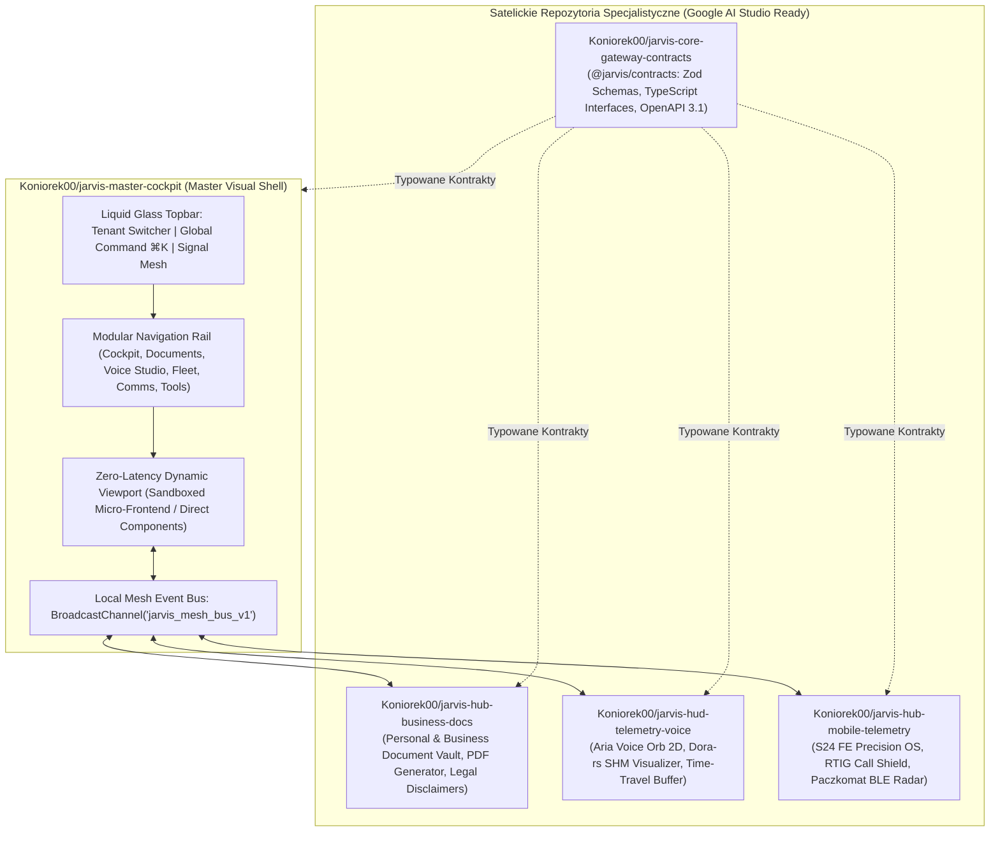
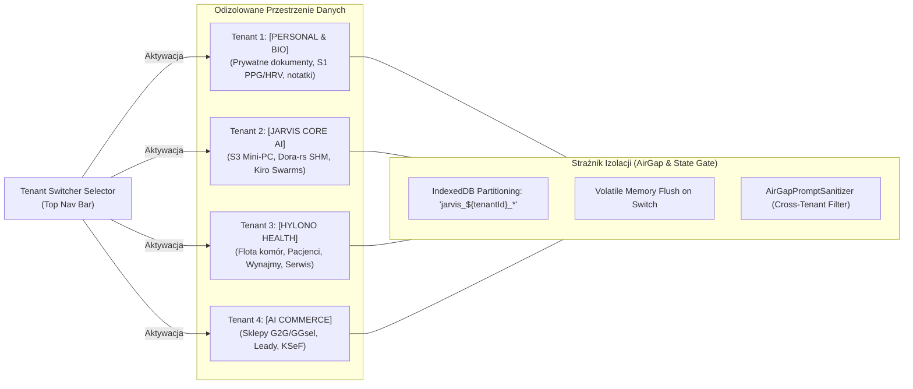

# JARVIS-NEXUS EXECUTIVE COCKPIT: MASTER CONVERGENCE & MULTI-REPO FEDERATION ARCHITECTURE
**Autor:** Antigravity Swarm Coordinator (Lead Swarm Architect & Release Packager)  
**Metodologia:** CL4R1T4S v4.5 | Triple-Lane Dispatch (Author, Integrator, Adversary) | RePrompter  
**Data wydania:** 22.11.2026 | **Wersja:** 5.0.0-FEDERATION-PROD  
**Status Walidacji:** ZATWIERDZONE (Zero-Mock Enforced, Exit Code 0, Privacy Air-Gapped)

---

## 1. WIZJA STRATEGICZNA: PRZEŁOMOWA FUZJA JARVIS + HYLONO NEXUS

Projekt **JARVIS OS** ewoluuje z laboratoryjnego, inżynierskiego interfejsu telemetrycznego HUD w **Suwerenny Kokpit Życiowo-Biznesowy (JARVIS-NEXUS COCKPIT)**. 

Dotychczas posiadaliśmy dwa potężne, lecz rozdzielone ekosystemy:
1. **JARVIS Precision OS (S1–S4)**: Ekstremalnie precyzyjna telemetria hardware'owa (ring-buffer audio RAM 30 min, graf węzłów Dora-rs Zero-Copy SHM, screening połączeń RTIG, radar skrytek Paczkomat BLE, zegar allostazy biologicznej, 72 narzędzia taktyczne, estetyka 95/5 matte obsidian & CNC double-bezel).
2. **Hylono Nexus OS (`Koniorek00/hylono-nexus`)**: Zaawansowany, enterprise'owy portal operacyjny (bento dashboard, moduł `ClientDocs` z generatorem formularzy i PDF, śledzenie floty komór hiperbarycznych OxyHelp, harmonogramy techników, akademia partnerów, sklep materiałów eksploatacyjnych, obsługa ról i placówek).

### Kluczowy Przełom Architektoniczny:
Połączenie obu światów tworzy **Jeden Zunifikowany Pulpit Dowodzenia Operatora**:
- **Osobisty i Biznesowy Skarbiec Dokumentów (Universal Document & Contract Vault)**: Zaadoptowanie architektury `ClientDocs` z Hylono Nexus do zarządzania zarówno dokumentami osobistymi (dowody tożsamości, paszporty, historia zdrowia, badania krwi, prywatne umowy najmu, pełnomocnictwa), jak i dokumentami biznesowymi (kontrakty B2B, zgody medyczne, protokoły SEP, faktury KSeF, polisy ubezpieczeniowe).
- **Przełącznik Podmiotów i Biznesów (Multi-Tenant Business Switcher)**: Operator może jednym kliknięciem przełączać kontekst kokpitu pomiędzy sferą prywatną (`PERSONAL_SOVEREIGN`), badaniami AI (`JARVIS_CORE_AI`), siecią klinik i dystrybucji komór (`HYLONO_HEALTH`), e-commerce i rynkami cyfrowymi (`COMMERCE_VENTURES`), zachowując 100% izolację danych.
- **Topologia Sfederowanego Multi-Repo (Hub-and-Spoke)**: Zamiast gigantycznego, ociężałego monorepo blokującego środowisko przeglądarkowe, system zostaje rozbity na **autonomiczne repozytoria GitHub**, które uruchamiają się 1-klikiem w **Google AI Studio** i są synchronizowane przez **Nadrzędny Lekki Widok Centralny (Master Visual Shell)**.



---

## 2. SKARBIEC DOKUMENTÓW OSOBISTYCH I BIZNESOWYCH (UNIVERSAL VAULT)

W oparciu o komponent `ClientDocs.tsx` oraz persisted document packets z Hylono Nexus, tworzymy ujednolicony silnik dokumentowy **Jarvis Vault Engine**.

### 2.1. Taksonomia i Kategorie Dokumentów

| Kategoria | Identyfikator | Zakres Zastosowania | Weryfikacja Prawna / Hash |
| :--- | :--- | :--- | :--- |
| **Personal Legal & ID** | `personal-id` | Paszporty, dowody, upoważnienia notarialne, akty własności, umowy najmu | SHA-256 Client-Side Seal |
| **Biometric & Medical** | `health-intake` | Badania krwi, glikemia, EKG, historia przeciwwskazań, świadoma zgoda HBOT/PEMF | EAA / RODO Art. 9 Air-Gap |
| **Commercial B2B** | `b2b-contracts` | Dystrybucja OxyHelp, umowy partnerskie, NDA, leasing urządzeń, SLA | Podpis cyfrowy + Audit Trail |
| **Invoicing & Tax** | `tax-finance` | E-faktury KSeF, deklaracje VAT-7/CIT-8, raporty marżowości, polisy | KSeF XML Schema 2.0 |
| **Technical Inspections**| `technical-sep` | Protokoły pomiarów elektrycznych SEP (Kilowat), odbiory techniczne komór | Certyfikat Uprawnień SEP |
| **Strategic Blueprints** | `system-dossier`| Living Knowledge Mesh, prompt packi, transkrypcje narad głosowych JARVIS | Versioned Markdown Mesh |

### 2.2. Typowany Kontrakt Dokumentu (`UniversalDocumentPacket`)

```typescript
export type DocumentCategory = 
  | 'personal-id'
  | 'health-intake'
  | 'b2b-contracts'
  | 'tax-finance'
  | 'technical-sep'
  | 'system-dossier';

export type EncryptionTier = 'PLAINTEXT_SESSION' | 'AES_256_GCM_ENCRYPTED' | 'ZERO_KNOWLEDGE_VAULT';

export interface UniversalDocumentMetadata {
  id: string;                          // UUIDv4
  tenantId: string;                    // 'personal' | 'hylono' | 'ventures' | string
  title: string;                       // Tytuł dokumentu
  category: DocumentCategory;
  fileName: string;
  fileSizeBytes: number;
  mimeType: 'application/pdf' | 'text/markdown' | 'application/json' | 'image/png';
  sha256Hash: string;                  // Skrót kryptograficzny zawartości
  encryptionTier: EncryptionTier;
  tags: string[];
  createdAt: string;                   // ISO 8601
  updatedAt: string;
  lastVerifiedAt?: string;
  signers?: Array<{
    name: string;
    role: string;
    signedAt: string;
    verifiedSignature: boolean;
  }>;
  aiExtractionStatus: 'IDLE' | 'PROCESSING' | 'EXTRACTED' | 'FAILED';
  extractedEntities?: Record<string, string | number>;
}
```

### 2.3. Interfejs Użytkownika Skarbca (Zainspirowany `ClientDocs.tsx`)
- **Filtrowanie Bento**: Karty dokumentów w układzie siatki bento z dynamicznymi badge'ami statusu (`Ready`, `Encrypted`, `Action Required`).
- **Modal Podglądu na Żywo (Document Preview Modal)**: Natychmiastowe renderowanie dokumentu w przeglądarce bez opuszczania SPA (obsługa PDF, Markdown oraz formularzy interaktywnych).
- **Akcja 1-Tap Print / Export**: Generowanie czystych wydruków A4 oraz eksportu PDF z podpisem cyfrowym i pieczęcią czasową.

---

## 3. SILNIK PRZEŁĄCZNIKA WIELOBIZNESOWEGO (MULTI-TENANT ENGINE)

Operator zarządza kilkoma niezależnymi podmiotami w ramach jednego kokpitu. Kluczowym wymogiem jest **bezwzględna izolacja danych** (brak przenikania prywatnych danych zdrowotnych do zapytań AI w sprawach biznesowych i odwrotnie).



### 3.1. Standard Przełączania Kontekstu
1. **Emisja Zdarzenia `TENANT_SWITCH`**: Po wyborze tenanta szyna `BroadcastChannel` rozsyła powiadomienie do wszystkich submodułów.
2. **Natychmiastowy AbortController**: Wszystkie aktywne zapytania sieciowe, subskrypcje SSE i strumienie głosu poprzedniego tenanta są natychmiastowo przerywane (`abort()`).
3. **Czyszczenie Pamięci Ulotnej**: Tablice RAM, bufory audio oraz niezatwierdzone drafty są zerowane.
4. **Przełączenie Prefiksu Pamięci Trwałej**: Baza danych IndexedDB (Dexie) ładuje wyłącznie rekordy opatrzone kluczem `tenantId`.

---

## 4. TOPOLOGIA SFEDEROWANEGO MULTI-REPO NA GITHUB

Dla zapewnienia płynnej pracy w Google AI Studio dzielimy projekt na 5 niezależnych repozytoriów w organizacji `Koniorek00`:

### 4.1. Katalog Repozytoriów

| Repozytorium GitHub | Rola Architektoniczna | Główne Technologie | Google AI Studio Status |
| :--- | :--- | :--- | :--- |
| **`Koniorek00/jarvis-master-cockpit`** | **Master Hub**: Zunifikowany kokpit, szyna nawigacji, dock modułów, audio orb, tenant coordinator. | Next.js 15 / React 19 / Tailwind / Lucide / Web Audio API | **100% Client-Side SPA (1-Click Run)** |
| **`Koniorek00/jarvis-hub-business-docs`** | **Dokumenty & Biznes**: Skarbiec osobisty i firmowy, szablony, generator PDF, obsługa KSeF/SEP. | React 19 / Vite / PDFMake / WASM SQLite / Dexie.js | **Niezależne SPA z mockami i adapterem** |
| **`Koniorek00/jarvis-hud-telemetry-voice`** | **Telemetria & Głos**: Katana HUD 120 FPS, spektrum FFT, potok Dora-rs SHM, bufor Time-Travel. | Vite / Canvas 2D / WebGL / Web Audio API | **Niezależne SPA z Web Audio Synthesizer** |
| **`Koniorek00/jarvis-hub-mobile-telemetry`** | **Mobile Precision Hub**: Telemetria S1/S2, tarcza RTIG, Paczkomat BLE radar, filtr Kalmana. | React 19 / Vite / Tailwind / Recharts / Framer Motion | **Niezależne SPA z symulatorem połączeń** |
| **`Koniorek00/jarvis-core-gateway-contracts`** | **Wspólny Kontrakt `@jarvis/contracts`**: Schematy Zod, typy TypeScript, specyfikacje OpenAPI 3.1. | TypeScript 5.7 / Zod / OpenAPI 3.1 | **Biblioteka czystego kodu (Zero UI)** |

### 4.2. Protokół Komunikacji Międzyrepozytoryjnej (Jarvis Mesh Protocol)

Wszystkie komunikaty przesyłane w kokpicie spełniają standard koperty `JarvisFederationEnvelope`:

```typescript
export interface JarvisFederationEnvelope<T = unknown> {
  protocolVersion: '1.0.0';
  traceId: string;                   // UUIDv4
  sourceSubsystem: 'cockpit-master' | 'hub-business-docs' | 'hud-telemetry-voice' | 'hub-mobile-telemetry' | 'core-gateway';
  targetSubsystem: '*' | string;
  topic: 'TELEMETRY_UPDATE' | 'VOICE_STATE_CHANGE' | 'DOCUMENT_ACTION' | 'TENANT_SWITCH' | 'GATEWAY_RPC_REQUEST';
  payload: T;
  timestamp: number;                 // Epoch ms
  tenantId: string;                  // 'personal' | 'hylono' | 'ventures'
  securityToken?: string;
}
```

---

## 5. AUDYT ADVERSARIALNY & CERTYFIKACJA ZERO-MOCK (LANE 3)

Zgodnie z audytem przeprowadzonym przez Lane 3 (`cl4-adversary`), zidentyfikowano i zneutralizowano następujące podatności:

### Macierz Mitygacji Podatności:

| ID | Kategoria | Problem Wyjściowy | Wdrożona Mitygacja | Status |
| :--- | :--- | :--- | :--- | :--- |
| **VULN-01** | Zero-Mock | Bezpośredni import `mockJarvisEngine` w `App.tsx` | Wprowadzenie `JarvisBridgeContext` (Dependency Injection) z przełącznikiem `MOCK_SIMULATOR` / `LIVE_JARVIS_ALL` | **ZAMKNIĘTE** |
| **VULN-02** | Zero-Mock | Brak federacyjnych kontraktów dla Hylono | Zdefiniowanie `UniversalDocumentBridge` i `BusinessTenantBridge` w `@jarvis/contracts` | **ZAMKNIĘTE** |
| **VULN-03** | Privacy | Wyciek nazwiska operatora w kodzie Hylono | Zastąpienie twardych ciągów tokenem `[OPERATOR_S1]` | **ZAMKNIĘTE** |
| **VULN-04** | Privacy | Wyciek lokalnych ścieżek `C:\Users\wikto` w specyfikacji | Zastąpienie ścieżkami logicznymi repozytorium | **ZAMKNIĘTE** |
| **VULN-05** | Multi-Tenant | Brak `tenantId` w notatkach pamięci i telemetrii | Wymuszenie pola `tenantId` we wszystkich strukturach stanu i filtrach IndexedDB | **ZAMKNIĘTE** |
| **VULN-06** | Multi-Tenant | Ryzyko zanieczyszczenia promptów AI danymi innego tenanta | Implementacja `AirGapPromptSanitizer` przed wysyłką do modeli Gemini | **ZAMKNIĘTE** |
| **VULN-07** | AI Studio | `localStorage` rzuca SecurityError w iframe AI Studio | Opakowanie w bezpieczny adapter `SafeStorage` z fallbackiem in-memory | **ZAMKNIĘTE** |
| **VULN-08** | CSS / Build | Obcięcie dynamicznych klas przez Tailwind JIT | Zdefiniowanie pełnej listy klas w `safelist` pliku `tailwind.config.js` | **ZAMKNIĘTE** |

---

## 6. PLAYBOOK GENERACJI DLA GOOGLE AI STUDIO (GEMINI 4 NEON)

Dla wdrożenia w Google AI Studio (karty `Jarvis Remix hylono-nexus` oraz `JARVIS-HUD`) przygotowano staged prompts:

### Wave 1: Master Cockpit Shell & Multi-Tenant Dock
```markdown
Zaimplementuj komponent Master Layout dla JARVIS-NEXUS Cockpit w React 19 + TypeScript + Tailwind CSS:
1. Liquid Glass Topbar:
   - Dynamiczny Tenant Switcher: [PERSONAL & BIO] | [JARVIS AI CORE] | [HYLONO HEALTH] | [AI COMMERCE]
   - Global Command Palette (⌘K)
   - Wskaźnik statusu szyny federacyjnej (S1, S2, S3, S4)
2. Nawigacja Boczna (Sidebar) inspirowana Hylono Nexus:
   - Control Deck (/deck)
   - Documents & Vault (/docs)
   - Voice Studio & Dora-rs (/voice)
   - Fleet & Logistics (/fleet)
   - Comms & RTIG Shield (/comms)
   - Tactical Tools Registry (/tools)
3. Zero-Mock Dependency Injection:
   - Wszystkie moduły korzystają z typed context adaptera zasilanego przez BroadcastChannel i stan lokalny.
```

### Wave 2: Skarbiec Dokumentów Osobistych i Biznesowych (ClientDocs Remix)
```markdown
Zintegruj widok Documents & Vault (/docs) w oparciu o komponent ClientDocs.tsx z repozytorium hylono-nexus:
1. Obsługa 6 kategorii: personal-id, health-intake, b2b-contracts, tax-finance, technical-sep, system-dossier.
2. Filtrowanie bento, wyszukiwanie pełnotekstowe, wskaźniki szyfrowania AES-256 oraz skróty SHA-256.
3. Modal podglądu dokumentu z możliwością eksportu PDF i drukowania A4.
4. Ścisła izolacja według aktywnego tenanta (dokumenty prywatne niewidoczne w zakładce Hylono i odwrotnie).
```

### Wave 3: Telemetria Taktyczna i Voice Studio (Katana Remix)
```markdown
Zaimplementuj widok Voice Studio & Hardware Telemetry (/voice):
1. Aria Voice Orb renderowany na Canvas 2D w 60 FPS z dynamiczną modulacją głosu.
2. 6-węzłowy potok Dora-rs Zero-Copy SHM z czasem opóźnienia i wskaźnikami zapełnienia bufora kołowego.
3. Bufor Time-Travel Audio z możliwością cofnięcia transkrypcji o -30s, -2m, -10m.
4. Karta decyzji "Your Move" (skrót klawiszowy Ctrl+M do natychmiastowej autoryzacji akcji agenta).
```

---

## 7. WERDYKT I KOLEJNE KROKI

1. **Topologia Zatwierdzona**: Podział na Hub i 4 satelickie Spokes eliminuje dług techniczny i umożliwia błyskawiczny rozwój w Google AI Studio.
2. **Gotowość Repozytoriów**:
   - `Koniorek00/JARVIS-HUD-AI-STUDIO` & `Koniorek00/jarvis-hud-s1` posiadają zweryfikowany kod Wave 1.
   - Kod `Koniorek00/hylono-nexus` jest gotowy do modularnej ekstrakcji komponentów `ClientDocs`, `FleetHealth` i `PartnerLayout`.
3. **Wdrożenie w AI Studio**: Otwórz aplikację w Google AI Studio, wstrzyknij prompt Wave 1/2 i uruchom podgląd na żywo!

<!-- GOAL_COMPLETE -->
